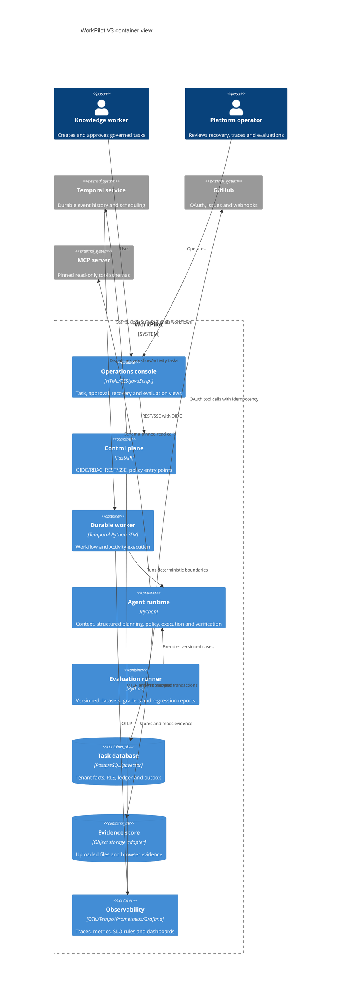
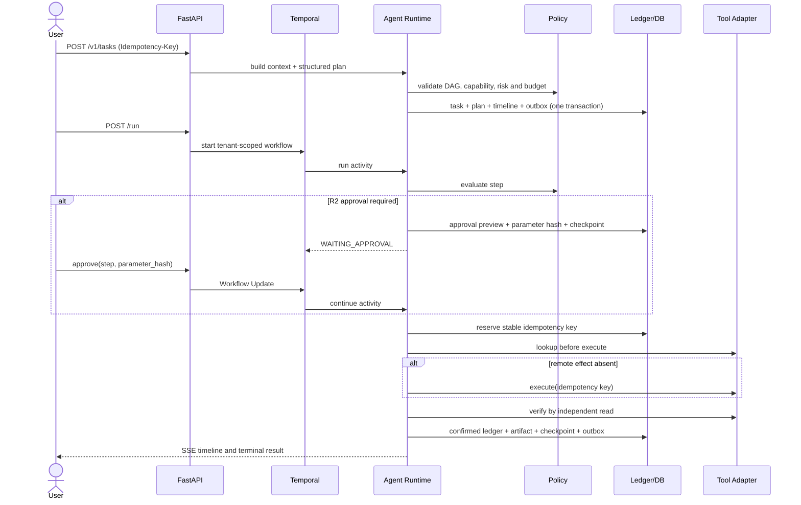
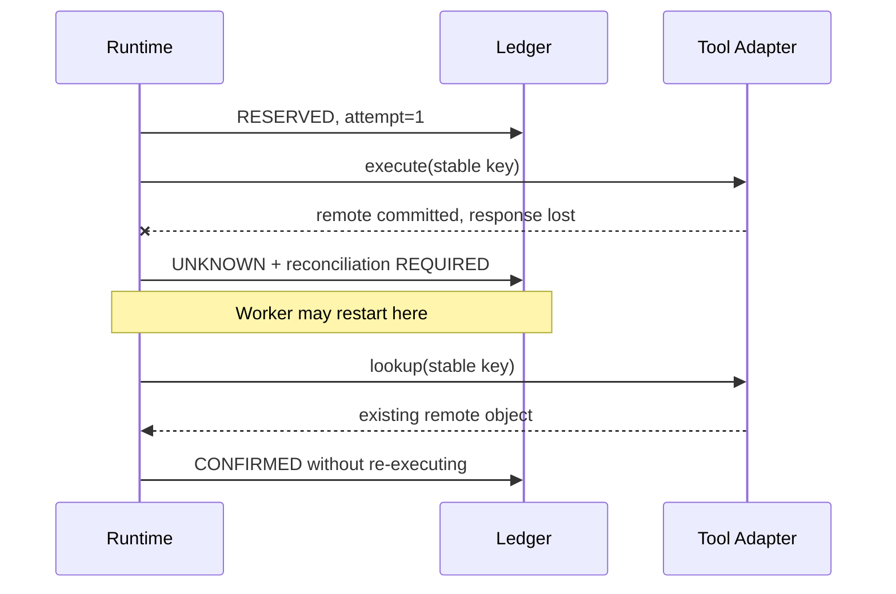

# WorkPilot V3 架构与关键时序

## C4：容器视图

实现保持“模块化单体 + 独立 Worker”。评测、API 和 Worker 是独立运行入口，但共享领域模型；
没有为了简历关键词提前拆微服务。

## 创建、审批与验证时序

## 响应丢失后的恢复时序

边界：Temporal 提供 at-least-once 调度，不提供外部 SaaS exactly-once。业务无重复的证据来自
稳定键、Ledger、lookup-before-retry 和独立远端核验的组合。
